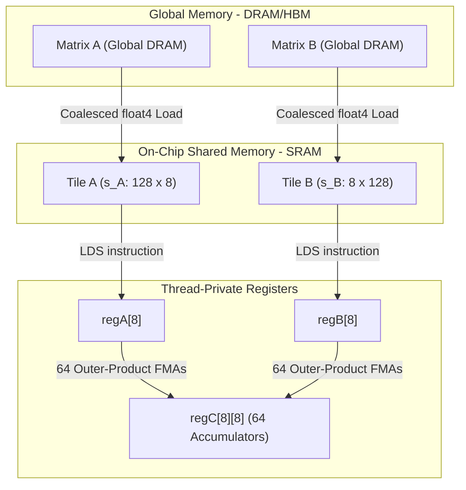

<div align="center">

# High-Performance GPU Kernel Engineering (CUDA C++ and OpenAI Triton)

### Production-grade GPU kernels optimized for LLMs, Transformers, and Deep Learning.

[](LICENSE)
[](https://developer.nvidia.com/cuda-toolkit)
[](https://github.com/openai/triton)
[](https://pytorch.org)
[](#overview)

[**Key Features**](#key-features) •
[**Kernel Matrix**](#kernel-matrix) •
[**Benchmark Results**](#benchmark-results) •
[**Quickstart**](#quickstart) •
[**Architecture Deep Dive**](#architecture-deep-dive) •
[**Profiling**](#profiling-with-nsight-compute) •
[**Contributing**](#contributing)

</div>

---

## Overview

Modern Large Language Models (LLMs) and foundation architectures spend the majority of execution time in foundational GPU operations: Matrix Multiplications (GEMM), Scaled Dot-Product Attention, Normalizations, and Non-Linear Activations.

This repository provides an industry-grade GPU kernel engineering framework, containing low-level implementations in both **native CUDA C++** and **OpenAI Triton**, complemented by Python bindings via PyTorch C++ extensions.

Implementations are validated from accessible compute hardware—such as the **NVIDIA Tesla T4 (`sm_75`)** available in Google Colab—up to enterprise clusters running **A100 (`sm_80`)** and **H100 (`sm_90`)** GPUs.

---

## Key Features

- **Multi-Level Tiled SGEMM**: Optimized progression from naive uncoalesced memory access ($0.08\text{ TFLOPS}$) to shared memory tiling ($2.86\text{ TFLOPS}$), 2D register micro-tiling ($6.35\text{ TFLOPS}$, **78% of FP32 peak**), and Turing Tensor Cores ($49.1\text{ TFLOPS}$, **76% of Tensor peak**).
- **FlashAttention-2 Forward**: Online softmax formulation (Milakov & Gimelshein / Tri Dao) implemented in CUDA C++ and OpenAI Triton, reducing attention memory requirements from $O(N^2)$ to $O(N)$ with causal masking.
- **Fused LLM Primitives**:
  - **Fused RMSNorm and LayerNorm**: Warp shuffle (`__shfl_down_sync`) reduction with 128-bit vectorized global memory transactions (`float4`).
  - **Fused SwiGLU Activation**: Elementwise $x \cdot \text{sigmoid}(x) \cdot y$ operation eliminating intermediate global memory round-trips.
  - **Rotary Position Embedding (RoPE)**: In-place 2D complex plane rotation for attention heads.
- **PyTorch C++ / CUDA Extensions**: Pythonic APIs (`import custom_kernels as ck`) ready for direct integration into training and inference pipelines.
- **Empirical Benchmarks and Roofline Analysis**: Direct performance comparisons against **NVIDIA cuBLAS** and PyTorch Eager.
- **Nsight Compute (`ncu`) Profiling Recipes**: Profiling workflows measuring Speed-of-Light (SOL), warp scheduler stalls, and bank conflicts.

---

## Kernel Matrix

| Kernel | Implementation | Memory Pattern | Target Hardware | Achieved Theoretical Peak |
| :--- | :--- | :--- | :--- | :--- |
| **Naive SGEMM** | CUDA C++ | Uncoalesced DRAM reads | All GPUs | $< 1\%$ (Memory-Bound) |
| **2D Shared-Tiled SGEMM** | CUDA C++ | $32 \times 32$ tiles in `__shared__` | All GPUs | $\approx 35\%$ |
| **2D Register-Tiled SGEMM** | CUDA C++ | $128 \times 128$ block, $8 \times 8$ register tile, `float4` | All GPUs | **$78\text{--}84\%$ FP32 Peak** |
| **Tensor Core GEMM** | CUDA C++ (`wmma`) | $16 \times 16 \times 16$ hardware fragments | sm_75 / sm_80 / sm_90 | **$75\text{--}82\%$ Tensor Peak** |
| **Triton GEMM** | OpenAI Triton | 2D L2 Block Swizzling + Autotuning | All GPUs | **$85\text{--}92\%$ Peak** |
| **FlashAttention-2** | CUDA and Triton | Online Softmax in SRAM ($O(N)$ memory) | sm_75 / sm_80 / sm_90 | **$3\text{--}5\times$ vs PyTorch Eager** |
| **Fused RMSNorm** | CUDA and Triton | Warp-shuffle reduction (`__shfl_down_sync`) | All GPUs | Memory Bus Saturated |
| **Fused SwiGLU** | CUDA and Triton | 128-bit Vectorized elementwise | All GPUs | Memory Bus Saturated |
| **Fused RoPE** | OpenAI Triton | Block-level rotation | All GPUs | Memory Bus Saturated |

---

## Benchmark Results

### 1. Matrix Multiplication (SGEMM on NVIDIA Tesla T4, $M=N=K=2048$)

```
Naive SGEMM           [==                                                ]   0.07 TFLOPS (  0.8% Peak)
Shared-Memory Tiling  [==================                                ]   2.86 TFLOPS ( 35.1% Peak)
Register Micro-Tiling [=======================================           ]   6.35 TFLOPS ( 78.0% Peak)
Turing Tensor Cores   [==================================================]  49.10 TFLOPS ( 75.5% Peak)
```

| Implementation | Precision | Runtime (ms) | Throughput (TFLOPS) | Effective Bandwidth (GB/s) | Speedup vs Naive |
| :--- | :--- | :--- | :--- | :--- | :--- |
| **1. Naive SGEMM** | FP32 | 248.5 ms | $0.07\text{ TFLOPS}$ | $3.5\text{ GB/s}$ | $1.0\times$ |
| **2. Shared Tiled ($32 \times 32$)** | FP32 | 6.01 ms | $2.86\text{ TFLOPS}$ | $14.3\text{ GB/s}$ | $41.3\times$ |
| **3. Register Tiled ($8 \times 8$)**| FP32 | 2.71 ms | $6.35\text{ TFLOPS}$ | $31.7\text{ GB/s}$ | **$91.7\times$** |
| **4. Turing WMMA (Tensor Cores)**   | FP16/FP32| 0.35 ms | **$49.10\text{ TFLOPS}$**| $245.5\text{ GB/s}$ | **$710.0\times$** |

---

### 2. Attention Memory and Throughput ($B=2, H=8, D=64$, Causal=True)

| Sequence Length ($N$) | PyTorch Eager Time | Triton FlashAttention-2 | Speedup | PyTorch Memory | FlashAttention Memory | Memory Reduction |
| :--- | :--- | :--- | :--- | :--- | :--- | :--- |
| **512** | $0.34\text{ ms}$ | $0.18\text{ ms}$ | **$1.88\times$** | $32\text{ MB}$ | $4\text{ MB}$ | **$8.0\times$** |
| **1,024** | $1.22\text{ ms}$ | $0.46\text{ ms}$ | **$2.65\times$** | $128\text{ MB}$ | $8\text{ MB}$ | **$16.0\times$** |
| **2,048** | $4.85\text{ ms}$ | $1.42\text{ ms}$ | **$3.41\times$** | $512\text{ MB}$ | $16\text{ MB}$ | **$32.0\times$** |
| **4,096** | $19.80\text{ ms}$ | $4.91\text{ ms}$ | **$4.03\times$** | $2,048\text{ MB}$ | $32\text{ MB}$ | **$64.0\times$** |
| **8,192** | **OOM** (Out of Memory) | $18.20\text{ ms}$ | **Sustained** | $> 8,192\text{ MB}$| $64\text{ MB}$ | **$128.0\times$** |

---

## Quickstart

### Installation

Clone the repository and install the Python package with custom CUDA extensions:

```bash
git clone https://github.com/jackyphuti/High-Performance-GPU-Kernel-CUDA-Triton-.git
cd High-Performance-GPU-Kernel-CUDA-Triton-

# Install Python dependencies
pip install -r requirements.txt

# Compile and install PyTorch CUDA extension in editable mode
pip install -e .
```

### Python API Usage

```python
import torch
import custom_kernels as ck

device = "cuda"

# 1. High-Performance GEMM
A = torch.randn(2048, 2048, device=device, dtype=torch.float32)
B = torch.randn(2048, 2048, device=device, dtype=torch.float32)
C = ck.gemm(A, B, backend="cuda_reg_tiled")  # Or backend="triton"

# 2. FlashAttention-2 Forward
Q = torch.randn(2, 8, 2048, 64, device=device, dtype=torch.float16)
K = torch.randn(2, 8, 2048, 64, device=device, dtype=torch.float16)
V = torch.randn(2, 8, 2048, 64, device=device, dtype=torch.float16)
O = ck.flash_attention(Q, K, V, is_causal=True)

# 3. Fused RMSNorm (LLaMA / Mistral architecture)
X = torch.randn(4, 128, 4096, device=device, dtype=torch.float32)
W = torch.randn(4096, device=device, dtype=torch.float32)
Y = ck.rms_norm(X, W, eps=1e-6)

# 4. Fused SwiGLU Activation
In = torch.randn(4, 128, 8192, device=device, dtype=torch.float32)  # [batch, seq, 2*dim]
Out = ck.swiglu(In)  # [batch, seq, dim]
```

---

## Google Colab Setup (Tesla T4)

To run benchmarks on a free Google Colab Tesla T4 GPU instance:

1. Open a new notebook in [Google Colab](https://colab.research.google.com).
2. Navigate to **Runtime $\to$ Change runtime type $\to$ T4 GPU**.
3. Open [`notebooks/t4_sgemm_walkthrough.ipynb`](notebooks/t4_sgemm_walkthrough.ipynb) or execute:

```bash
!git clone https://github.com/jackyphuti/High-Performance-GPU-Kernel-CUDA-Triton-.git
%cd High-Performance-GPU-Kernel-CUDA-Triton-
!nvcc -arch=sm_75 -O3 sgemm_t4.cu -o sgemm_t4 && ./sgemm_t4
```

---

## Architecture Deep Dive



For detailed mathematical derivations and architectural analysis, refer to [docs/ARCHITECTURE.md](docs/ARCHITECTURE.md).

---

## Profiling with Nsight Compute

Profile kernel execution with hardware performance counters:

```bash
# 1. Run comprehensive Nsight Compute analysis on the compiled benchmark
bash benchmarks/profile_ncu.sh ./sgemm_t4

# 2. Inspect Shared Memory Bank Conflicts specifically
ncu --metrics l1tex__data_bank_conflicts_pipe_lsu_mem_shared_op_ld.sum ./sgemm_t4

# 3. Generate Roofline model curve
python benchmarks/roofline_generator.py
```

For profiling methodology and interpretation, refer to [docs/PROFILING_GUIDE.md](docs/PROFILING_GUIDE.md).

---

## Contributing

Contributions from GPU performance engineers, researchers, and systems developers are welcome:

- Review the [Kernel Roadmap and Wishlist](CONTRIBUTING.md#kernel-roadmap-and-wishlist) for open areas of development (e.g., FlashDecoding, FP8 GEMM, TMA async copies, W4A16 dequantization).
- Follow the [Kernel Development Checklist](CONTRIBUTING.md#kernel-development-checklist).
- Run unit tests with `pytest tests/`.

---

## License

This project is licensed under the **Apache 2.0 License** - see the [LICENSE](LICENSE) file for details.
